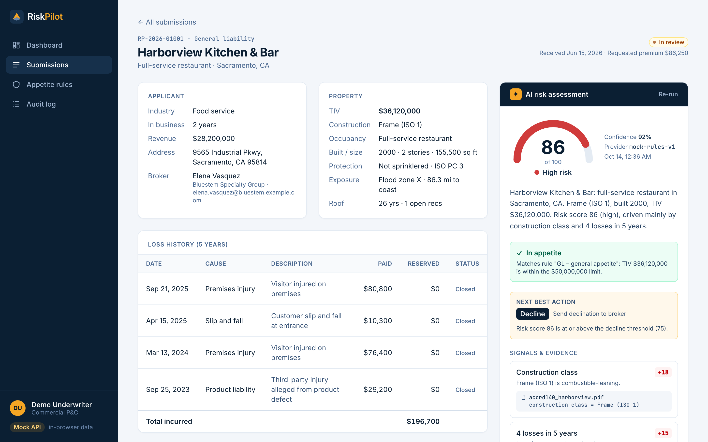
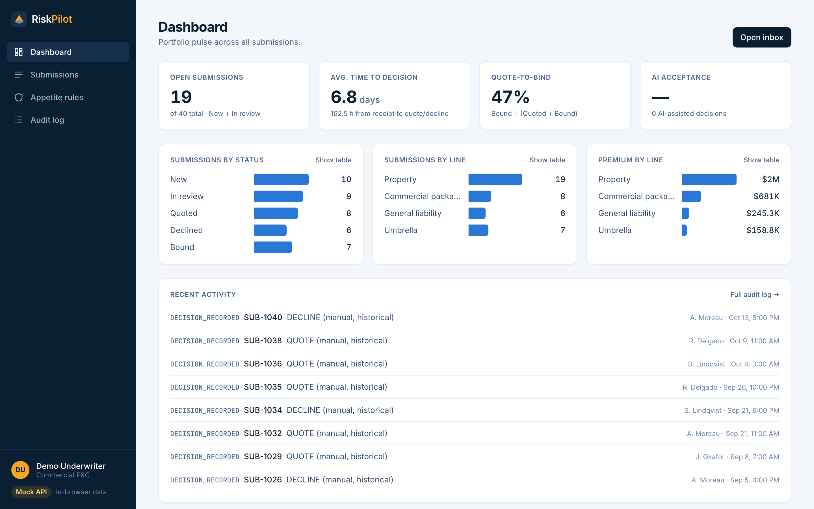
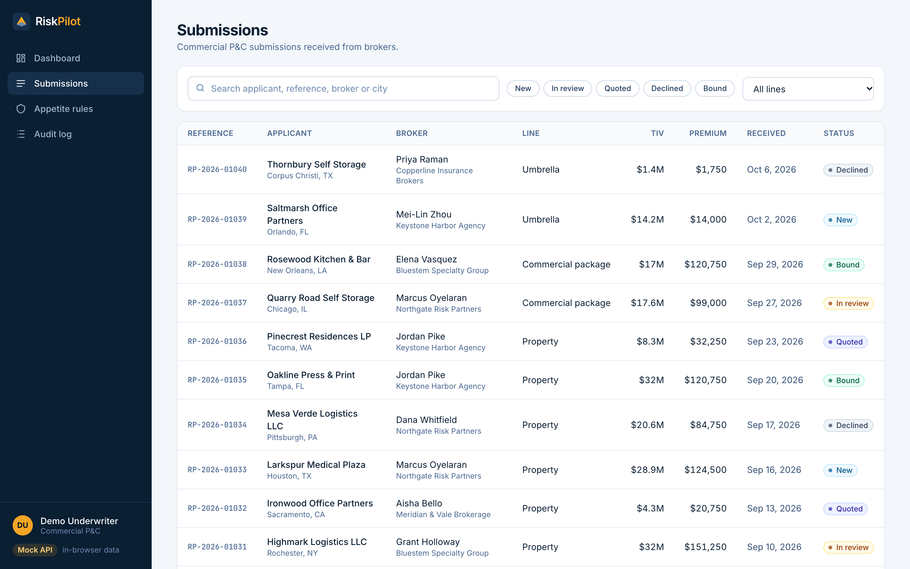
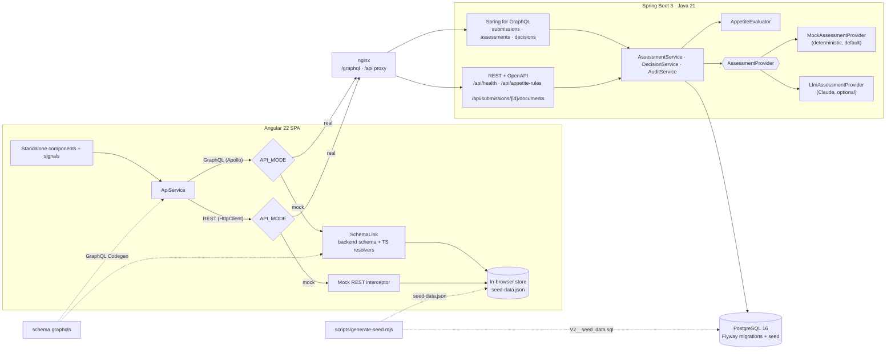

# RiskPilot

[](https://github.com/weblinkify/riskpilot/actions/workflows/ci.yml)
[](https://riskpilot-field-iq1.vercel.app)

**An AI co-pilot for commercial P&C underwriters.** RiskPilot triages broker submissions, scores each risk with
explainable signals that cite the exact document and field they came from, checks the carrier's appetite, and
suggests a next step. The underwriter always makes the call, and every call is audited.

**Live demo:** https://riskpilot-field-iq1.vercel.app (mock mode, runs entirely in your browser, no sign-up)



<details open>
<summary><strong>Demo: inbox → assessment → cited evidence → override with reason → audit log</strong></summary>


</details>

> Portfolio project. All companies, brokers, people and figures are synthetic. Not affiliated with any insurer or vendor.

---

## Features

| | |
|---|---|
| **Submissions inbox** | Status (New, In review, Quoted, Declined, Bound), broker, line, TIV, premium, received date; search, status/line filters and pagination, all reflected in the URL. |
| **Submission workbench** | Applicant, property (construction, occupancy, protection, exposure, TIV), 5-year loss history with totals, documents with extracted fields, and document upload. |
| **AI risk assessment** | Risk score 0–100 with band and confidence; every signal shows its points and a **citation (document + field + value)** that opens the source document; appetite fit with reasons; a *next best action* (Quote, Refer, Request info, Decline) with rationale. |
| **Human in the loop** | The AI only recommends. The underwriter **accepts**, or **overrides** with a mandatory reason (≥ 10 chars, enforced server-side). Decisions, assessments, uploads and rule changes go to an append-only **audit log**. |
| **Appetite rules admin** | CRUD for carrier rules (line, state, minimum ISO construction class, max TIV, active). Every assessment uses them, and changing a rule changes the next assessment. |
| **Dashboard** | Open submissions, average time to decision, quote-to-bind ratio, AI acceptance rate, and charts by status and by line (count and premium), each with a table view. |
| **Landing page** | Short marketing page with an **Open demo** button. |

## Screenshots

| Dashboard | Inbox |
|---|---|
|  |  |

## Architecture



## Tech stack

| Layer | Choice |
|---|---|
| Frontend | Angular 22 (standalone components, signals, `rxResource`, zoneless), TypeScript strict, Tailwind CSS v4, Apollo Angular 14 / Apollo Client 4, Angular HttpClient |
| Types | GraphQL Code Generator (`typescript-operations` + `typed-document-node`) from the backend schema, committed and checked in CI |
| Backend | Java 21, Spring Boot 3.5, Spring for GraphQL, Spring Web, Spring Data JPA, Bean Validation, springdoc-openapi (Swagger UI), Anthropic Java SDK (optional) |
| Data | PostgreSQL 16, Flyway (`V1` schema, `V2` 40 synthetic submissions + 6 appetite rules) |
| Tests | JUnit 5, AssertJ, Testcontainers (Postgres), Spring GraphQL Tester, MockMvc; Vitest (Angular unit-test builder); Playwright |
| Ops | Multi-stage Dockerfiles (JRE / nginx), docker compose profiles, GitHub Actions, Vercel |

## Real vs. mock API

The UI talks to one `ApiService`. **What sits behind it is decided at runtime by `API_MODE`:**

| | `API_MODE=real` | `API_MODE=mock` |
|---|---|---|
| GraphQL | Apollo `HttpLink` → `/graphql` (Spring for GraphQL) | Apollo `SchemaLink`: executes queries in the browser against the **same `schema.graphqls`**, with TypeScript resolvers |
| REST | `HttpClient` → `/api/**` (Spring MVC) | `HttpClient` interceptor that answers the same endpoints |
| Data | PostgreSQL seeded by Flyway | `seed-data.json`, persisted to `localStorage` per browser |
| Scoring | `MockAssessmentProvider` (Java) or Claude | Line-by-line TypeScript port of the Java scorer |

Why the two modes stay identical:

* **One seed.** `scripts/generate-seed.mjs` (deterministic PRNG) writes both `V2__seed_data.sql` and `seed-data.json`. CI re-runs it and fails on a diff.
* **One schema.** Codegen emits the operation types *and* the schema SDL the mock `SchemaLink` executes, so mock resolvers can't drift from the real contract. CI fails if generated files are stale.
* **One scoring algorithm, two implementations, one golden file.** `AssessmentParityIT` (Java, Testcontainers) and `assessment-engine.spec.ts` (TypeScript) must both reproduce `assessment-golden.json` for all 40 submissions.
* **One e2e suite.** The same Playwright tests run against mock (CI, Vercel) and real (Docker) builds.

`env.js` carries the mode: it is written by `tools/write-env.mjs` at build time (npm/Vercel) and regenerated by the nginx entrypoint at container start, so **one Docker image serves both modes**. The mock layer and seed data are lazy-loaded chunks, so real-mode users never download them.

## Running locally

**Prerequisites:** Node 24, Java 21, Docker (for Postgres, Testcontainers and compose).

### Docker (both profiles)

```bash
cp .env.example .env                     # optional – defaults work

docker compose --profile real up --build # postgres + backend + frontend → http://localhost:4200
docker compose --profile mock up --build # frontend only, in-browser API → http://localhost:4200
```

In the real profile the backend is also exposed on http://localhost:8080:
Swagger UI at `/swagger-ui.html`, GraphiQL at `/graphiql`, health at `/api/health`.
Every service has a healthcheck, and the frontend waits for a healthy backend, which waits for a healthy Postgres.

### npm (development)

```bash
# Mock mode – no backend needed
cd frontend && npm ci && npm start                  # http://localhost:4200

# Real mode – Postgres + Spring Boot, Angular dev-server proxies /graphql and /api to :8080
docker compose --profile real up -d postgres
cd backend && ./mvnw spring-boot:run
cd frontend && npm run start:real
```

### Use Claude for assessments (optional)

```bash
ASSESSMENT_PROVIDER=llm ANTHROPIC_API_KEY=sk-ant-... docker compose --profile real up
```

Without a key the app logs a warning and keeps using the deterministic provider. Nothing in the app requires a key.

## Environment variables

| Variable | Where | Default | Purpose |
|---|---|---|---|
| `API_MODE` | frontend (build / container) | `mock` | `mock` = in-browser API, `real` = Java backend |
| `API_BASE_URL` | frontend build | *(same origin)* | Absolute backend URL if not proxied |
| `BACKEND_URL` | frontend container | `http://backend:8080` | nginx proxy target in real mode |
| `DATABASE_URL` | backend | `jdbc:postgresql://localhost:5432/riskpilot` | JDBC URL |
| `DATABASE_USER` / `DATABASE_PASSWORD` | backend | `riskpilot` / `riskpilot` | DB credentials |
| `POSTGRES_DB` / `POSTGRES_USER` / `POSTGRES_PASSWORD` | compose | `riskpilot` | Postgres container |
| `ASSESSMENT_PROVIDER` | backend | `mock` | `mock` or `llm` |
| `ANTHROPIC_API_KEY` | backend | *(empty)* | Required only for `llm` |
| `ANTHROPIC_MODEL` | backend | `claude-opus-5-5` | Model for the LLM provider |
| `CORS_ALLOWED_ORIGINS` | backend | `http://localhost:4200` | Allowed browser origins |
| `PORT` | backend | `8080` | HTTP port |

Secrets go in `.env` (gitignored); `.env.example` documents everything.

## Testing

| Suite | Command | What it covers |
|---|---|---|
| Backend unit | `cd backend && ./mvnw test` | Appetite evaluator, scoring bands, recommendation logic, citation coverage, LLM grounding guards (18 tests) |
| Backend integration | `cd backend && ./mvnw verify` | Testcontainers Postgres + Flyway: GraphQL queries and mutations, filters and pagination, accept/override (incl. reason rule), audit trail, dashboard KPIs, REST CRUD and validation, uploads, OpenAPI, Java/TS golden parity (11 tests) |
| Frontend unit | `cd frontend && npm run test:ci` | TS scorer vs. golden file, mock GraphQL resolvers (filters, decisions, override guard, KPIs), mock REST interceptor, components (13 tests) |
| E2E | `cd frontend && npm run e2e` | Landing → dashboard, inbox paginate/filter/search, open submission, run assessment with citations, accept, override with reason, rule CRUD, rule change drives assessment (8 tests) |
| E2E vs. any build | `E2E_BASE_URL=http://localhost:4200 npx playwright test` | Same suite against Docker real/mock or the live site |
| Lint / types / codegen | `npm run lint && npm run format:check && npm run typecheck && npm run codegen:check` | |

Results at the time of writing: backend 29/29, frontend unit 13/13, and the e2e suite 8/8 against **mock dev server, Docker mock profile, Docker real profile (run twice against the persistent DB), and the live Vercel deployment**.

Media is reproducible too: `npm run media` captures the screenshots and demo video with Playwright and converts the video to `docs/demo.gif` with ffmpeg (fails if ≥ 5 MB).

## CI

`.github/workflows/ci.yml` runs on every push and PR:

1. **Frontend:** `npm ci` → ESLint + Prettier → `tsc` (app, specs, e2e) → **codegen check** → **seed check** → unit tests
2. **Backend:** `./mvnw verify` (unit + Testcontainers integration tests)
3. **Docker + e2e:** build both images (BuildKit GHA cache) → run the frontend image with `API_MODE=mock` → Playwright e2e against that container → upload the Playwright report as an artifact

npm and Maven caches are enabled.

## Design decisions & trade-offs

* **Human in the loop by construction.** No code path turns an assessment into a status change. Only `DecisionService.record` does, and only with an underwriter identity. Overrides need a reason, enforced on the server (not just the form), and the decision and its audit row are written in one transaction. The AI acceptance rate on the dashboard makes model–human disagreement visible.
* **Evidence over eloquence.** Every signal carries a citation to a document id + extracted field. The LLM provider is *grounded*: deterministic extraction produces candidate signals with citations, Claude selects the material ones, sets the score and writes the narrative, and **any signal it names that isn't in the candidate list is dropped**. Appetite is a hard constraint: an out-of-appetite risk can never be recommended for QUOTE, whatever the model says. On any API error it falls back to the deterministic result and labels the provider accordingly.
* **Provider abstraction.** `AssessmentProvider` is a small strategy interface (`assess(input) → draft`). The default mock is deterministic, so tests, demos and the golden parity check are stable. Swapping in another model or vendor is one class and one config switch.
* **Why mock mode exists.** A reviewer should be able to click through the product in seconds without running Java or Postgres, and Vercel can't host the backend. Mock mode executes the *real* GraphQL schema in the browser instead of hand-written fixtures, and the parity checks above keep it honest. The cost is maintaining a TypeScript port of the scorer. I accepted that cost and covered it with the golden-file test.
* **GraphQL + REST split.** Read-heavy, nested workbench data (submission → losses, documents, latest assessment, decisions) is GraphQL with `@BatchMapping` to avoid N+1. Admin CRUD and file upload are REST, where HTTP semantics, multipart and OpenAPI fit better.
* **Runtime config, one image.** `API_MODE` is read from `env.js` at startup rather than baked in, so the same image is promoted across modes and environments.
* **Appetite semantics.** State-specific rules are authoritative for their state; construction class is a minimum ISO class; ties break on highest max TIV. Being slightly over the limit (≤ 25 %) yields REFER rather than DECLINE.
* **Deliberate simplicity.** No auth, single demo underwriter, uploads store metadata only. Each is listed below rather than half-built.

## Built vs. planned

**Built and verified**

- [x] Inbox with search, status/line filters, pagination (URL state)
- [x] Submission detail: applicant, property, loss history, documents (extracted fields), document upload (metadata)
- [x] AI assessment: score, band, confidence, cited signals, appetite fit with reasons, next best action + rationale
- [x] Accept / override with mandatory reason; append-only audit log (per submission + global)
- [x] Appetite rules CRUD (REST + validation) used by every assessment
- [x] Dashboard KPIs + charts by status and line
- [x] Landing page
- [x] `MockAssessmentProvider` (default) and `LlmAssessmentProvider` (Claude, optional, grounded, with fallback)
- [x] PostgreSQL + Flyway + 40 synthetic submissions; OpenAPI / Swagger UI; GraphiQL
- [x] Real and mock API modes, Docker images, compose profiles with healthchecks
- [x] Backend unit + Testcontainers tests, frontend unit tests, Playwright e2e in both modes
- [x] CI pipeline; Vercel deployment (mock mode)

**Not built / planned**

- [ ] Authentication, roles and authority limits (the underwriter is a fixed demo identity)
- [ ] Real document ingestion: file bytes aren't stored, and uploaded files get no field extraction (seeded documents have pre-extracted fields)
- [ ] An OpenAI provider (the abstraction supports it; only Claude is implemented)
- [ ] The LLM provider's grounding/guard logic is unit-tested, but it has not been exercised against the live API in CI (needs a key)
- [ ] Bind workflow (Quoted → Bound transitions only exist in seed data), pricing/rating, broker messaging
- [ ] Pagination/sorting options beyond "newest first"; audit log export
- [ ] Hosted real-mode backend (the live demo is mock mode only)

## Project layout

```
backend/            Spring Boot app (domain, assessment engine, GraphQL + REST, Flyway)
frontend/           Angular app, mock API layer, Playwright e2e, Dockerfile + nginx
scripts/            Seed generator, GIF converter
docs/               Screenshots and demo GIF (captured by Playwright)
docker-compose.yml  real / mock profiles
```

## License

MIT. See [LICENSE](LICENSE).
